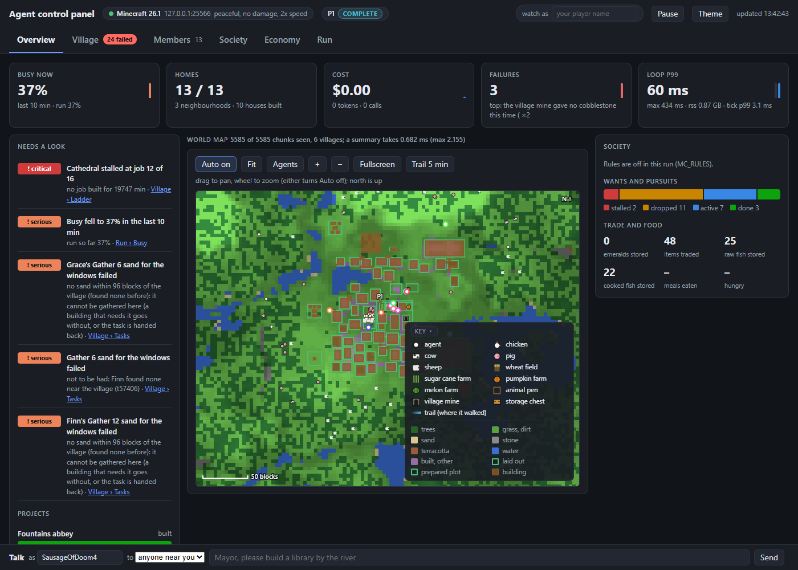
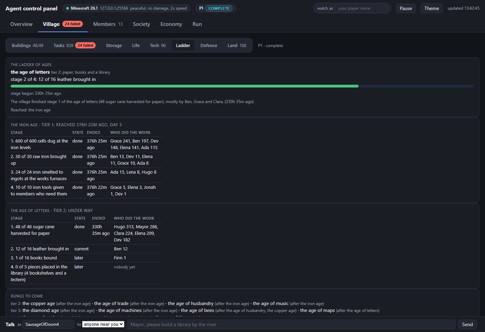
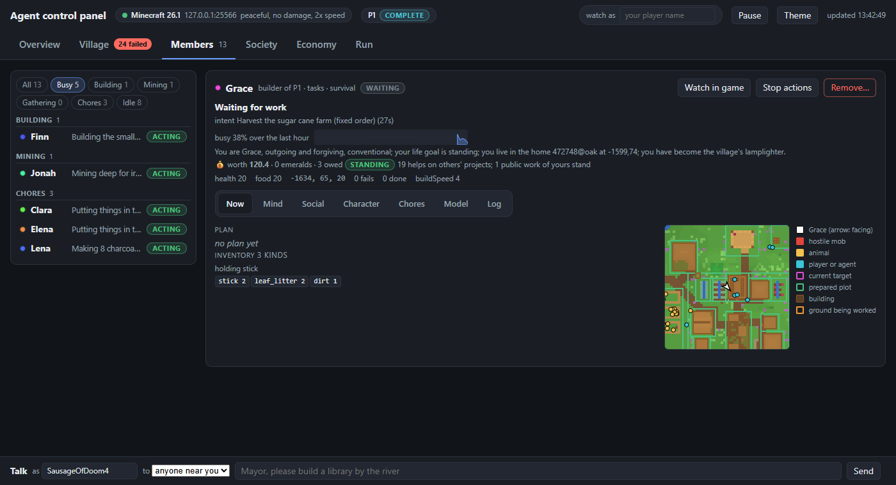
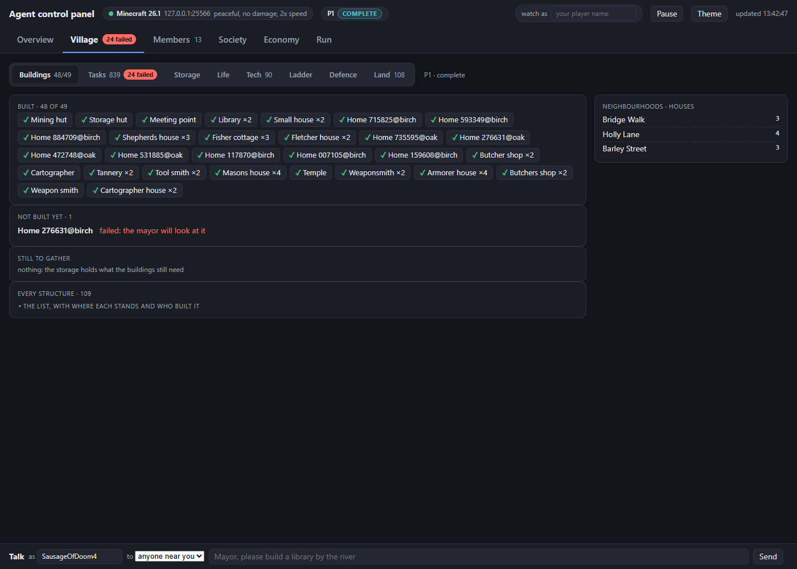

# MCAI Sandbox

Teams of LLM agents that found and run villages in Minecraft. A mayor agent chooses the land and the buildings; worker
agents gather, craft and smelt the materials, keep them in shared storage and build every building in survival, each
block paid for from their inventories. Once the village stands they keep it going: they farm, keep animals, mine, make
goods, furnish the houses, vote on what to build next and build it. It is a base for multi-agent experiments in the
spirit of [Project Sid](https://arxiv.org/html/2411.00114v1), with up to 25 agents in one village.

The agents play real Minecraft Java Edition 26.1 (a local Paper server, each agent a
[Mineflayer](https://github.com/PrismarineJS/mineflayer) bot). A browser voxel sandbox written for this project serves as
a quick test bed; the brains, skills and API are the same in both.



## What the agents do

1. **Found a village.** The mayor searches for a level, dry site with trees near it, chooses houses from Minecraft's own
   village pieces for that biome (or has an architect model draw one), and lays the village out. Code places the
   buildings along streets with a storage hut, a mine, a wheat field, lamps and name signs, and posts the work as tasks.
2. **Build it from nothing.** Workers claim the tasks: clear the plot, gather logs, mine cobblestone, smelt glass, then
   build each building from storage. A shortfall posts tasks for exactly what is missing.
3. **Live there.** Each idle member chooses a chore from a menu: harvest and bake, start farms, pen and breed animals,
   dig for iron, make goods the village lacks (a catalogue generated from the game's recipes), furnish the houses, light
   the buildings, explore. Members have personalities (five traits) that tilt what they choose.
4. **Start projects of their own.** A member can start a small work (a well, a bench, a market stall, a gazebo, a
   statue, lamp posts) and others join it: the crew gathers its materials and builds it. When the plots are full, the
   first step is to prepare a new green beside the village.
5. **Grow and decide together.** Houses are added until there is one per member. With housing on, each house has an
   owner whose name is on its sign: a member without a house starts a street of houses itself (after a vote on its
   style), and owners furnish and light their own homes first. The village also votes on its next public work, a
   quarter of shops, smithies, libraries or temples (or "no new work for now"), and builds the winner. Every member
   casts a ballot with a reason in its own words.
6. **Notice what the village needs.** Code measures the village's needs (unlit buildings, unfurnished rooms, hungry
   members, houses short, storage space, mine faces) and shows them to the members beside the chores that answer them.
   Leftover building parts get a chest of their own and the wooden ones are burned as furnace fuel.
7. **Make homes of their own.** Each member's house is drawn for it by the building generator (or written by a model as
   a short program), with a planks floor, its own bed, chest and table, furniture and decorations its owner places,
   front gardens of flowers, and walls "dressed" with footings, quoins and sills so no two buildings look alike.
8. **Climb the ladder of ages.** After the iron age the village votes at dawn on its next ambition, among the rungs
   whose earlier rungs are reached and simpler ones first: letters (books and a library), copper, trade, husbandry,
   music, then diamond, machines, bees and maps, then enchantment and the sea, and last the Nether (a portal and
   expeditions for ancient debris). Each rung has four stages counted by code from the work members do; members see the
   village's progress in their prompts, and with payments on the village pays a small emerald wage for each chore that
   fed the current stage.
9. **Trade with a merchant.** A trader in the first market stall sells what a peaceful world lacks (string, bone,
   gunpowder, redstone, bee nests...) and buys the village's surplus, all for emeralds; the age of trade adds stalls,
   orders and an emerald store.
10. **Raise public buildings and monuments.** A complete village raises civic buildings (guildhalls, market halls, mills,
    inns, lighthouses, clock towers, drawn by code from real ones), then a monument: a Gothic cathedral (Salisbury,
    Cologne, Notre Dame...) or a castle (Conwy, the White Tower), at 1:3 of the real building, stage by stage, from its
    own quarry and kiln.
11. **Build what people ask for.** A player's line in chat ("build us a statue of a chicken", "Salisbury cathedral
    here") becomes a request: the Mayor answers in one line and the village builds a pre-designed building, a named
    monument, or a work the architect model designs (up to 30x30x30, in any block the village can get).
12. **Survive.** The world is peaceful by default, but it can be made harder in stages (`MC_WORLD_MODE`): damage
    (falls, drowning, fire), real hunger and nights (members eat to stay healed and sleep in beds made from their own
    sheep's wool), and hostile mobs. With monsters, members keep home by dusk while the nights run long, fight back or
    flee, arm themselves with swords, bows and armour, hunt at night when monsters come near, and vote on a fence ring
    round the village and later a stone castle wall with towers and gatehouses.

Housing, the parts chest, homes, gardens, the merchant, talk builds, the rungs and survival's defences are on by
default; the ladder itself and the iron age that the ladder, the civic tier and the monuments start from are switched on
by the run profiles (`profiles/*.json`), and needs by `MC_NEEDS=on` (see [docs/RUNBOOK.md](docs/RUNBOOK.md) and
[docs/SETTINGS.md](docs/SETTINGS.md)). In the best run so far, members chose their own work 45% of the time after the
village was built, starting six streets of their own.

## How it works

Each agent is a player with a body, an inventory and the same rules as a human player. A **brain** on the server decides
what it does; the body carries it out as **skills** (`collect block=logs count=12`, `build_design ...`), which are the
models' tools and end in a message saying what happened and what to do next.

- **A two-tier brain.** A planner model writes a goal and a few steps; an executor model turns each step into tool
  calls. Every role runs on `gpt-oss:120b-cloud` through Ollama by default, with local models as a fallback.
- **Models decide; code does the arithmetic and the geometry.** Code works out recipes and bills of materials, places
  buildings, checks designs and guards against loops; the models choose the site, the buildings, the chores and the
  votes, and what to do when something fails.
- **Activities as data.** Chores and goods are activity specs checked by a validator; later phases let members propose
  new ones.
- **A skill foundry.** New skills are written by an outside coding agent (the Antigravity CLI by default, or Claude
  Code) on a branch of its own, then pass gates: a scope check, the typecheck, the offline checks, a review, a live test
  on a test world of its own and a run compared with a baseline; a candidate that passes every gate is merged. Its
  skills so far shear sheep, fish, trade with the merchant, gather string from cobwebs and harvest honeycomb and
  amethyst.

[docs/ARCHITECTURE.md](docs/ARCHITECTURE.md) shows how the parts fit together, with diagrams.

## The control panel

http://127.0.0.1:8766/panel follows everything live without joining the game, in six tabs, each with its own sub-tabs
(every one has an address, such as `#/village/tasks/failed` or `#/members/Ada/mind`). **Overview** is the page to leave
open: the village's numbers, the world map beside who is doing what, what needs a look and what happened. **Village**:
buildings, tasks, storage, life (farms, pens, lights, growth), the tech tree, the **ladder** (the current rung, its tier
and stage, every rung's stages with who did the work, the rung ballots and their tallies, the wages, who is away in the
Nether), defence (walls, members' arms, watches and hunts, in a world with monsters) and the land. **Members**: a list, and one
member's Now (plan, inventory, its map), Mind (journal, intention, notes), Social, Chores (its last chore menu), Model
(its **thoughts**, what the executor and planner saw) and Log. **Society**: **votes** (every ballot with its reason),
**initiatives**, proposals, rules, **needs** and culture. **Economy**: the market, wealth, the board, research, goals.
**Run**: how busy the members are, the scorecard, how chores were chosen, models and cost, every event, and the run's
switches. A feature that is off keeps its tab, marked off, with its flag inside.

The screenshots show a saved village (48 buildings in three neighbourhoods, a cathedral under way) taken up again with 13
members on 2026-11-19.







## Where it stands

Every rung of the ladder (thirteen, in five tiers) is implemented and has been reached in a live run: iron and letters
from a fresh village, the others from a saved village started on that rung (`MC_LADDER_START`). One village climbing the
whole ladder in a single run is not yet shown: long climbs stall on members left idle. Work in progress:

- **50 agents.** On a separate branch (`scale-50`), each bot's body runs in a process of its own beside one brain
  server, so a village can hold up to 50 members; it is to be merged into the main line.
- **Idle members.** Making sure each member of a large village always has useful work: more miners per iron level, more
  projects open at once, and options that guards had taken off a menu put back. In a 75-minute climb this cut the time
  members spent with nothing to choose, after the first 50 minutes, from about 80% to about 55%; the aim is under 30%.
- **Emergence.** The longer-term goals are specialisation, collective rules and culture as in Project Sid, memory over
  hours and days, and new activities learned through the skill foundry; members' memory, character, votes, rules,
  proposals and the foundry are in place, and the ladder is the current focus.

## Running it

You need Node.js, Python 3 and the Ollama app (signed in, for the cloud models).

```bash
npm install
npm run mc:setup     # once: portable Java 25 and a Paper 26.1.2 server in mc/ (127.0.0.1 only)
# accept the Minecraft EULA: eula=true in mc/server/eula.txt
npm run mc:server    # the Minecraft server (stop it with: python mc/rcon.py stop, which saves the world)
npm run mc:agents    # the agent server: API on http://127.0.0.1:8766/api, panel on /panel
```

Then start a village (the watcher finds land near X Z, spawns a mayor and workers and follows them):

```bash
MCAI_API=http://127.0.0.1:8766/api MCAI_GAMEMODE=survival \
  python scripts/watch_village.py MyVillage 120 0 2 60 "a house for each of us and a storage hut"
```

`2` is the number of workers (up to 24) and `60` the minutes allowed. The browser sandbox runs with `npm run dev`
(http://localhost:5173); see [docs/SANDBOX.md](docs/SANDBOX.md).

## Documentation

| | |
|---|---|
| [docs/ARCHITECTURE.md](docs/ARCHITECTURE.md) | How the system fits together |
| [docs/RUNBOOK.md](docs/RUNBOOK.md) | Running, testing and benchmarking: every script, setting and check |
| [docs/SETTINGS.md](docs/SETTINGS.md) | Every `MC_*`/`MCAI_*` setting with its default (generated from `server/src/settings.ts`) |
| [docs/specs/](docs/specs/) | Specs of recent work: the ladder's rungs, castle walls, requested builds, chat tests |
| [docs/API.md](docs/API.md) | The REST API, to control agents from any language |
| [GitHub issues](https://github.com/delphium226/MCAISandbox/issues) | The roadmap and the todo list, by goal milestone (G1-G8) and label; [docs/ISSUES.md](docs/ISSUES.md) maps the older issue numbers used in commits and notes |
| [docs/PLAN.md](docs/PLAN.md) | The current work's handover and each phase's design |
| [docs/RUNS.md](docs/RUNS.md), [docs/FINDINGS.md](docs/FINDINGS.md), [docs/LESSONS.md](docs/LESSONS.md) | Every run, what it found, and what was learned |
| [docs/SANDBOX.md](docs/SANDBOX.md) | The browser sandbox |

## Project layout

```
server/src             the agent framework: brains, skills, villages, layouts, designs, the panel's API
server/src/mineflayer  the real-Minecraft adapter (the world, skills, building, storage, mine, workshop)
server/panel           the control panel (one HTML page)
shared/src, client/src the browser sandbox's game
scripts/               run, staging, check and benchmark scripts (scripts/foundry.py and scripts/foundry/: the foundry)
mc/                    the local Minecraft server's scripts (jar, Java and worlds are gitignored)
patches/               patch-package patches for Mineflayer and mineflayer-pathfinder
docs/                  the documentation above
```
