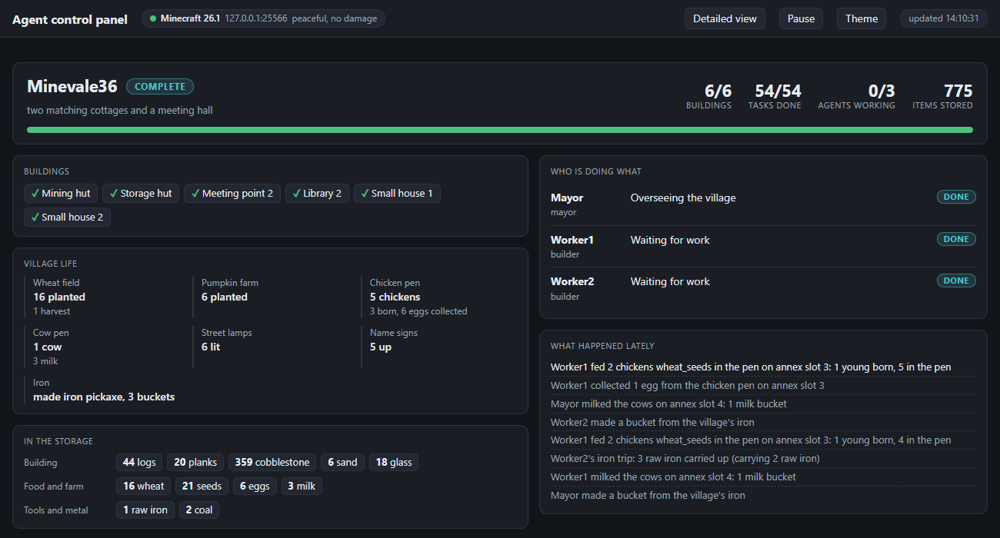
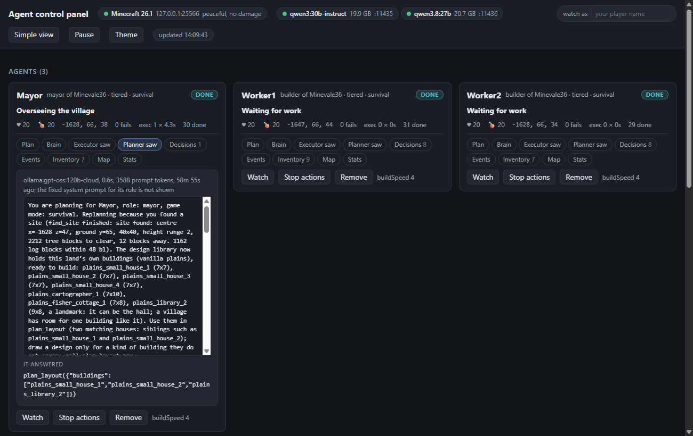

# MCAI Sandbox

Teams of LLM agents that found and run villages in Minecraft. A mayor agent chooses the land and the buildings; worker
agents gather, craft and smelt the materials, keep them in shared storage and build every building in survival, each
block paid for from their inventories. Once the village stands they keep it going: they farm, keep animals, mine, make
goods, furnish the houses, vote on what to build next and build it. It is a base for multi-agent experiments in the
spirit of [Project Sid](https://arxiv.org/html/2411.00114v1), with up to 25 agents in one village.

The agents play real Minecraft Java Edition 26.1 (a local Paper server, each agent a
[Mineflayer](https://github.com/PrismarineJS/mineflayer) bot). A browser voxel sandbox written for this project serves as
a quick test bed; the brains, skills and API are the same in both.



## What the agents do

1. **Found a village.** The mayor searches for a level, dry site with trees near it, chooses houses from Minecraft's own
   village pieces for that biome (or has an architect model draw one), and lays the village out. Code places the
   buildings along streets with a storage hut, a mine, a wheat field, lamps and name signs, and posts the work as tasks.
2. **Build it from nothing.** Workers claim the tasks: clear the plot, gather logs, mine cobblestone, smelt glass, then
   build each building from storage. A shortfall posts tasks for exactly what is missing.
3. **Live there.** Each idle member chooses a chore from a menu: harvest and bake, start farms, pen and breed animals,
   dig for iron, make goods the village lacks (a catalogue generated from the game's recipes), furnish the houses, light
   the buildings, explore. Members have personalities (five traits) that tilt what they choose.
4. **Start projects of their own.** A member can start a small work (a well, a bench, a market stall, a gazebo, a
   statue, lamp posts) and others join it: the crew gathers its materials and builds it. When the plots are full, the
   first step is to prepare a new green beside the village.
5. **Grow and decide together.** Houses are added until there is one per member. With housing on, each house has an
   owner whose name is on its sign: a member without a house starts a street of houses itself (after a vote on its
   style), and owners furnish and light their own homes first. The village also votes on its next public work, a
   quarter of shops, smithies, libraries or temples (or "no new work for now"), and builds the winner. Every member
   casts a ballot with a reason in its own words.
6. **Notice what the village needs.** Code measures the village's needs (unlit buildings, unfurnished rooms, hungry
   members, houses short, storage space, mine faces) and shows them to the members beside the chores that answer them.
   Leftover building parts get a chest of their own and the wooden ones are burned as furnace fuel.

Housing, needs and the parts chest are newer features, switched on by settings (`MC_HOUSING=on`, `MC_NEEDS=on`,
`MC_PARTS=on`; see [docs/RUNBOOK.md](docs/RUNBOOK.md)). In the best run so far, members chose their own work 45% of
the time after the village was built, starting six streets of their own.

## How it works

Each agent is a player with a body, an inventory and the same rules as a human player. A **brain** on the server decides
what it does; the body carries it out as **skills** (`collect block=logs count=12`, `build_design ...`), which are the
models' tools and end in a message saying what happened and what to do next.

- **A two-tier brain.** A planner model writes a goal and a few steps; an executor model turns each step into tool
  calls. Every role runs on `gpt-oss:120b-cloud` through Ollama by default, with local models as a fallback.
- **Models decide; code does the arithmetic and the geometry.** Code works out recipes and bills of materials, places
  buildings, checks designs and guards against loops; the models choose the site, the buildings, the chores and the
  votes, and what to do when something fails.
- **Activities as data.** Chores and goods are activity specs checked by a validator; later phases let members propose
  new ones.
- **A skill foundry.** New skills are written by an outside coding agent (the Antigravity CLI by default, or Claude
  Code) on a branch of its own, then pass gates: a scope check, the typecheck, the offline checks, a review, a live test
  on a test world of its own and a run compared with a baseline. A person merges the result. Its first skill,
  `shear_sheep` (wool, for beds), passed every gate.

[docs/ARCHITECTURE.md](docs/ARCHITECTURE.md) shows how the parts fit together, with diagrams.

## The control panel

http://127.0.0.1:8766/panel follows everything live without joining the game. The **simple view** follows a village
through its life: buildings, farms and pens, storage, who is doing what. The **detailed view** has a card per agent and
village, with tabs for an agent's plan, its **thoughts** (its recent model calls with their reasoning, its answers and
what it saw), its **memory** (temperament, the chores it has done and how they ended, its memory fields) and its
**votes**, and a village's tasks, buildings, storage, **votes** (every ballot with its reason), **initiatives** (who
started what, who joined) and **needs** (each gauge's level and whether anyone is answering it). A world map shows
everything the bots have seen.



## Running it

You need Node.js, Python 3 and the Ollama app (signed in, for the cloud models).

```bash
npm install
npm run mc:setup     # once: portable Java 25 and a Paper 26.1.2 server in mc/ (127.0.0.1 only)
# accept the Minecraft EULA: eula=true in mc/server/eula.txt
npm run mc:server    # the Minecraft server (stop it with: python mc/rcon.py stop, which saves the world)
npm run mc:agents    # the agent server: API on http://127.0.0.1:8766/api, panel on /panel
```

Then start a village (the watcher finds land near X Z, spawns a mayor and workers and follows them):

```bash
MCAI_API=http://127.0.0.1:8766/api MCAI_GAMEMODE=survival \
  python scripts/watch_village.py MyVillage 120 0 2 60 "a house for each of us and a storage hut"
```

`2` is the number of workers (up to 24) and `60` the minutes allowed. The browser sandbox runs with `npm run dev`
(http://localhost:5173); see [docs/SANDBOX.md](docs/SANDBOX.md).

## Documentation

| | |
|---|---|
| [docs/ARCHITECTURE.md](docs/ARCHITECTURE.md) | How the system fits together |
| [docs/RUNBOOK.md](docs/RUNBOOK.md) | Running, testing and benchmarking: every script, setting and check |
| [docs/API.md](docs/API.md) | The REST API, to control agents from any language |
| [GitHub issues](https://github.com/delphium226/MCAISandbox/issues) | The roadmap and the todo list, labelled by phase |
| [docs/PLAN.md](docs/PLAN.md) | The current work's handover and each phase's design |
| [docs/RUNS.md](docs/RUNS.md), [docs/FINDINGS.md](docs/FINDINGS.md), [docs/LESSONS.md](docs/LESSONS.md) | Every run, what it found, and what was learned |
| [docs/SANDBOX.md](docs/SANDBOX.md) | The browser sandbox |

## Project layout

```
server/src             the agent framework: brains, skills, villages, layouts, designs, the panel's API
server/src/mineflayer  the real-Minecraft adapter (the world, skills, building, storage, mine, workshop)
server/panel           the control panel (one HTML page)
shared/src, client/src the browser sandbox's game
scripts/               run, staging, check and benchmark scripts (scripts/foundry.py and scripts/foundry/: the foundry)
mc/                    the local Minecraft server's scripts (jar, Java and worlds are gitignored)
patches/               patch-package patches for Mineflayer and mineflayer-pathfinder
docs/                  the documentation above
```
