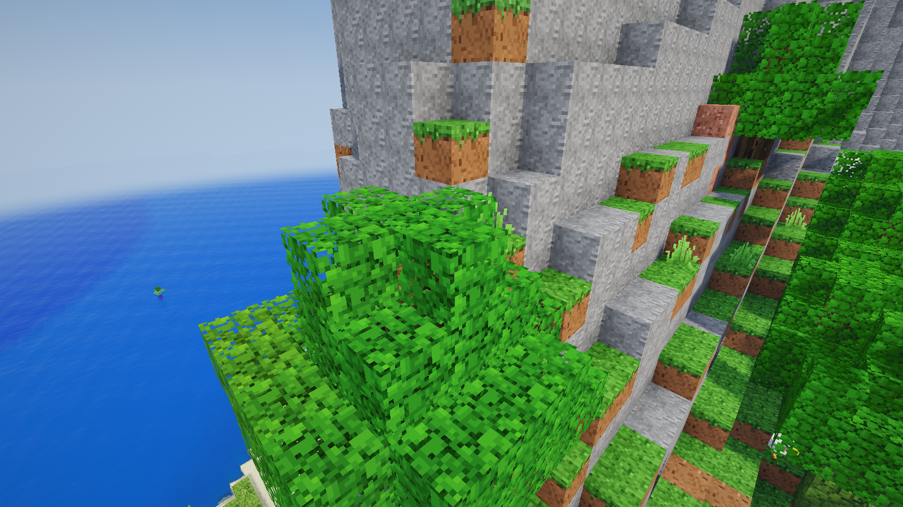
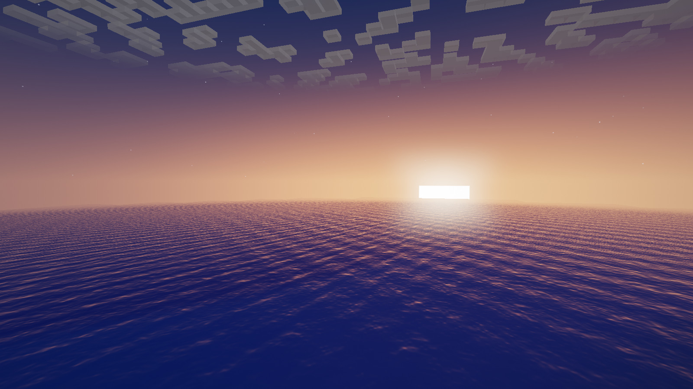

# The browser sandbox (the test bed)

A Minecraft-style voxel game that runs in the browser, backed by an authoritative Node.js server, written for this
project. It came first: the agents were developed in it before the real-Minecraft adapter existed, and it remains a
quick test bed for the brains (the village economy is Minecraft only). Human players and agents share its world. All
textures, skins, sounds, music and the UI font are generated procedurally in code; no Mojang assets are used.




## Running the sandbox

`npm run dev` starts the game server on :8765 and the Vite client on :5173; open http://localhost:5173, pick a name and
press **Play** (more tabs add more players).

For production, build the client once and let the game server serve it:

```bash
npm run build        # outputs dist/
npm start            # http://localhost:8765 serves the game, the WebSocket and the API
```

Server options (flags or `MC_*` environment variables):

| Flag | Default | Meaning |
|---|---|---|
| `--port` | `8765` | HTTP + WebSocket port |
| `--world` | `world` | World save folder (`server/worlds/<name>`) |
| `--seed` | random | Number or text seed (only used when a new world is created) |
| `--view-distance` | `10` | Chunks sent to human players |
| `--pvp` | `true` | Player-vs-player damage |
| `--agents` | `0` | Number of AI agents to spawn at start-up |
| `--agent-brain` | `worker` | Brain for those agents (`worker`, `companion`, `idle`, `llm`) |

For example: `npx tsx server/src/index.ts --world test --seed hello`.

## What's in the game

- **World:** infinite procedurally generated terrain with 15 biomes: oceans, beaches, plains, forests, birch forests, taiga, snowy taiga and plains, deserts, savanna, windswept hills, snowy peaks, swamps and meadows. It has rivers, caves (spaghetti tunnels and large caverns), underground lava lakes, ore veins, and oak, birch and spruce trees. Flowers, grass, sugar cane, cacti and pumpkins are scattered around.
- **Survival:**
  - Health, hunger and saturation, with natural regeneration.
  - Damage from falling, drowning, lava, fire and starvation.
  - Death drops your items and shows a respawn screen.
  - Beds set your spawn point and skip the night.
- **Mining and building:** break times follow Minecraft's formula (hardness × tool tier × tool speed). Tools wear out, blocks drop the right items, and pickup behaves like Minecraft. You can place blocks with orientation (logs, furnaces, torches, ladders, slabs, stairs), and two slabs merge into a full block. Doors are two blocks tall and open and close; fences and cobblestone walls connect to their neighbours.
- **Crafting:** 95 shaped and shapeless crafting recipes plus 21 smelting recipes, including tools and armour in 5 materials, torches, chests, furnaces, beds, doors, stairs, fences, walls, food and building blocks.
  - 2×2 grid in the inventory, 3×3 grid on the crafting table.
  - Shift-click crafts in bulk; drag with the mouse to split stacks.
- **Smelting:** a furnace with fuel burn time and cooking progress: ores, food, sand to glass, and more.
- **Containers:** chests.
- **Experience:** XP orbs from mining ores, killing mobs and smelting fly to the nearest player and fill a green XP bar with a level number (Minecraft level formula); you drop some XP when you die.
- **Creative mode:** a tabbed, searchable item palette and flying.
- **Mobs:** pig, cow, sheep (dyed and shearable), chicken, zombie, skeleton (shoots arrows), creeper (explodes) and spider.
  - Animals wander, panic when hit and follow you when you hold wheat or seeds.
  - Monsters spawn in the dark, and undead mobs burn in daylight.
- **Simulation:**
  - Water and lava flow; lava meeting water makes obsidian or cobblestone.
  - Sand and gravel fall, and leaves decay.
  - Grass spreads, crops, saplings, sugar cane and cacti grow, and farmland hydrates.
  - TNT explodes and sets off nearby TNT.
- **Multiplayer:** see other players with skins, name tags, held items and animations. There is chat, a player list (Tab) and server commands (`/help`).
- **Saving:** the world is saved to disk: chunks you changed, player data, and container contents.

## Graphics
WebGL2 through Three.js, with a custom deferred-style pipeline:

- **Terrain:** smooth lighting and ambient occlusion using Minecraft-style sky and block light that spreads across chunks. Chunks are meshed in Web Workers.
- **Shadows:** real-time sun and moon shadows with two cascades and PCF filtering.
- **Water:** animated waves, refraction of the scene below, colour absorption with depth, Fresnel reflections of the sky, **screen-space reflections** and sun highlights. Being underwater adds fog.
- **Sky and time of day:** a sky model with sunrise and sunset glow, a square sun and moon, twinkling stars, and a 20-minute day/night cycle.
- **Clouds:** Minecraft-style block clouds.
- **Weather:** rain and snow (snow in cold biomes), thunderstorms with lightning, an overcast sky, ground that looks wet, and rain sounds. Use `/weather clear|rain|thunder`.
- **Foliage and lava:** leaves and plants sway in the wind; lava glows and flows.
- **Post-processing:** HDR tone mapping (ACES), bloom, god rays, vignette and dithering.
- **Particles:** block-break debris, torch flames and smoke, explosions, bubbles and critical-hit sparks.
- **Title screen:** a rotating 3D panorama of a world generated locally.
- **Settings:** each effect can be turned off in *Options*.

Controls: WASD, Space, Shift (sneak), Ctrl or double-tap W (sprint), mouse, 1–9 or the scroll wheel, E (inventory),
Q (drop), T or / (chat), F1 (hide the HUD), F3 (debug screen), F5 (camera view), Tab (player list), middle-click (pick block).

## In-game commands

Useful commands: `/gamemode creative|survival|spectator`, `/time set day|night`, `/give <item> [count]`, `/tp x y z`,
`/summon <mob>`, `/weather rain`, `/gamerule doMobSpawning false`, `/agent ...` (see below).

```
/agent spawn Alex farmer worker     # name, role, brain
/agent do Alex collect block=logs count=8
/agent do Alex give player=@me item=oak_log count=4
/agent list
/agent stop Alex
/agent remove Alex
```
